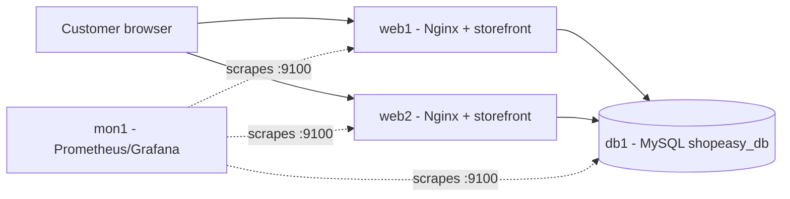
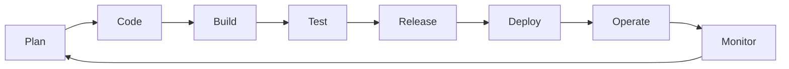

# ShopEasy - DevOps Case Study & Ansible Automation

**Scenario:** ShopEasy, a small e-commerce application (product catalogue, cart, checkout, orders).
**Goal:** Show the DevOps lifecycle for the app and automate server configuration with Ansible.

---

## 1. Why DevOps for an e-commerce app?

| Business need | DevOps answer |
|---|---|
| New features and offers released frequently | CI/CD pipeline, small frequent releases |
| Traffic spikes (sales, festivals) | Repeatable, scalable infrastructure via Ansible |
| Downtime = lost revenue | Monitoring, health checks, fast rollback |
| Payment/customer data must be safe | Automated tests, security scans, Ansible Vault for secrets |

## 2. Application architecture



- **Web tier** (`web1`, `web2`): Nginx serves the storefront.
- **Database tier** (`db1`): MySQL stores products, users, orders.
- **Monitoring tier** (`mon1`): Prometheus scrapes `node_exporter` on every server.

## 3. DevOps lifecycle / workflow



| Stage | What happens for ShopEasy | Tools / practices |
|---|---|---|
| **Plan** | Backlog of features (wishlist, coupons), sprint planning | GitHub Issues / Projects, Agile |
| **Code** | Developers work on feature branches, raise pull requests | Git, GitHub, code review |
| **Build** | App packaged on every push | GitHub Actions, Docker (optional) |
| **Test** | Unit tests, Ansible syntax check and lint, security scan | pytest/Jest, `ansible-lint`, `--syntax-check` |
| **Release** | Version tagged (e.g. v1.0.0) after PR merge | Git tags, semantic versioning |
| **Deploy** | Servers configured and app deployed identically every time | **Ansible** playbook `site.yml` |
| **Operate** | Config drift avoided by re-running idempotent playbook | Ansible, systemd |
| **Monitor** | CPU/memory/disk metrics, `/health` endpoint, alerts | Prometheus, Grafana, node_exporter |
| **Feedback** | Incidents and user feedback turn into new backlog items | GitHub Issues |

### Stages requested in the assignment

| Stage | In this project |
|---|---|
| **Development** | Git feature branches, pull requests, code review |
| **Testing** | CI job: `ansible-playbook --syntax-check`, `ansible-lint`, health check task |
| **Deployment** | `ansible-playbook site.yml` on `staging` group (CI `deploy-staging` job) |
| **Monitoring** | `node_exporter` on port 9100 installed by Ansible; `/health` endpoint on Nginx |

### Automation requirements identified
1. Install and configure Nginx on all web servers.
2. Deploy the storefront page from a template.
3. Install MySQL, create the database and application user.
4. Install monitoring agent on all servers.
5. Keep everything idempotent (safe to re-run) and reload services only when config changes (handlers).
6. Keep secrets out of plain text (use Ansible Vault in real use).

## 4. Repository structure

```
devops-ansible-ecommerce/
├── ansible.cfg
├── inventory.ini              # hosts grouped as web / db / monitoring / local
├── site.yml                   # main playbook (3 plays)
├── group_vars/all.yml         # variables
├── templates/
│   ├── nginx-shopeasy.conf.j2
│   └── index.html.j2
├── .github/workflows/ci.yml   # CI pipeline
├── DEMO_SCRIPT.md             # 5-7 min video script
└── README.md
```

## 5. How to run

### Prerequisites
- Control machine with Ansible (`sudo apt install ansible` or `pip install ansible-core`)
- Target VMs running Ubuntu with SSH access (or use the `local` group to run on your own Ubuntu machine/WSL)
- MySQL collection: `ansible-galaxy collection install community.mysql`

### Steps
```bash
# 1. Clone
git clone https://github.com/<your-username>/devops-ansible-ecommerce.git
cd devops-ansible-ecommerce

# 2. Edit inventory.ini with your VM IPs and users

# 3. Test connectivity
ansible all -m ping

# 4. Validate the playbook
ansible-playbook site.yml --syntax-check

# 5. Dry run
ansible-playbook site.yml --check --diff

# 6. Run for real
ansible-playbook site.yml

# 7. Run again - should show changed=0 (idempotency)
ansible-playbook site.yml

# 8. Verify
curl http://<web1-ip>/
curl http://<web1-ip>/health
curl http://<web1-ip>:9100/metrics | head
```

### Only the web tier / only your own machine
```bash
ansible-playbook site.yml --limit web
ansible-playbook site.yml --limit local        # runs the web play on localhost
```

## 6. Screenshots to capture (evidence)

1. GitHub repository page showing all files
2. `ansible --version` and `cat inventory.ini`
3. `ansible all -m ping` output (SUCCESS)
4. `ansible-playbook site.yml --syntax-check` output
5. First playbook run with the **PLAY RECAP** (changed tasks)
6. Second run showing `changed=0` (idempotency)
7. Browser showing the ShopEasy page and `/health`
8. `systemctl status nginx` and `systemctl status node_exporter`
9. GitHub Actions run (green tick) for CI

## 7. Key concepts used (for the viva/demo)

- **Inventory**: list of managed hosts, grouped (`web`, `db`, `monitoring`), with group variables.
- **Playbook**: YAML file of plays and tasks describing desired state.
- **Idempotency**: running it again changes nothing if the system is already correct.
- **Modules**: `apt`, `template`, `file`, `service`, `uri`, `unarchive`, `systemd`, `mysql_db`, `mysql_user`.
- **Handlers**: run only when notified (e.g. reload Nginx after config change).
- **Templates (Jinja2)**: one file generates per-host config using variables.
- **Variables**: `group_vars/all.yml` keeps values out of the tasks.
- **Check mode**: `--check --diff` previews changes.
- **Ansible Vault**: encrypts secrets such as `db_password`.

---

## 8. Running on AWS EC2

**Launch:** Ubuntu Server 22.04/24.04 AMI, t2.micro or t3.micro (free tier), create/download a key pair (`.pem`).

**Security group (inbound):**

| Port | Purpose | Source |
|---|---|---|
| 22 | SSH | My IP |
| 80 | Storefront (HTTP) | 0.0.0.0/0 |
| 9100 | node_exporter metrics | My IP (or the monitoring server) |
| 3306 | MySQL (multi-instance setup only) | Security group of the web server |

**Option A - single instance (easiest)**
```bash
chmod 400 mykey.pem
ssh -i mykey.pem ubuntu@<EC2_PUBLIC_IP>

sudo apt update && sudo apt install -y ansible git
ansible-galaxy collection install community.mysql
git clone https://github.com/<your-username>/devops-ansible-ecommerce.git
cd devops-ansible-ecommerce

ansible-playbook site.yml --limit local --syntax-check
ansible-playbook site.yml --limit local
ansible-playbook site.yml --limit local      # 2nd run: changed=0
```
Open `http://<EC2_PUBLIC_IP>/` and `http://<EC2_PUBLIC_IP>/health` in a browser.

**Option B - control node + targets:** copy your `.pem` to the control node (`chmod 400`), fill in the IPs and key name in `inventory.ini`, then `ansible all -m ping` and `ansible-playbook site.yml`.

**Amazon Linux?** The playbook uses `apt`, so use an Ubuntu AMI (user `ubuntu`). Amazon Linux would need `dnf` and `ec2-user`.

**Cost tip:** stop or terminate the instances after recording the demo.
